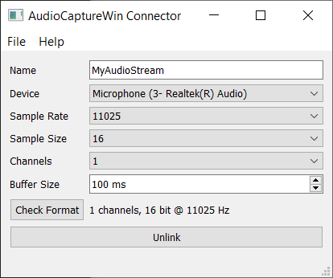

# Overview

The AudioCapture application uses Qt's [QAudioSource](https://doc.qt.io/qt-6/qaudiosource.html) for cross-platform audio capturing and streaming over [LSL](https://labstreaminglayer.org).

# Getting Started

Download the latest version [from the releases page](https://github.com/labstreaminglayer/App-AudioCapture/releases).

On Ubuntu there are two packages per release: `AudioCaptureCLI-*.deb` (the headless CLI, no Qt) and
`AudioCapture-*.deb` (the GUI, which needs the CLI package). For the CLI only:
`sudo apt install ./AudioCaptureCLI-*.deb`; for both: `sudo apt install ./AudioCapture*.deb`.

The Windows release requires vc_redist.x64.exe; if you don't already have it then you can install the download [from Microsoft](https://support.microsoft.com/en-gb/help/2977003/the-latest-supported-visual-c-downloads).

Using this app is very simple:

  * Make sure that you have connected a microphone to your computer.
  * Start the AudioCapture app. You should see a window like the following.
> 
  * Set the audio capture parameters.
    * Make sure the correct audio device is selected.
    * The preferred "Sample Size" should be 16. In our testing, 8- and 32-bits per sample did not produce useful data.
    * The number of output channels can be one or two depending on the connected microphone.
  * Click the "Link" button to link the app to the lab network. If successful, the button should turn into "Unlink".
  * If a firewall complains, allow the app to connect to the network.
  * Please allow microphone access if asked.
  * You should now have a stream on your lab network that has type "Audio" and its name is the name entered in the GUI.
  * Note that you cannot close the app while it is linked.

## Command-line (headless) mode

`AudioCaptureCLI` streams without a GUI, using the same capture path and stream metadata:

```
AudioCaptureCLI --list                         # capture APIs and their devices
AudioCaptureCLI -d 0 -n MyAudio -r 48000 --channels 2 -f Int16
AudioCaptureCLI -c AudioCapture.cfg            # settings from a GUI-saved config; flags override
AudioCaptureCLI --api ALSA -d 0 -f Int16       # Linux: raw hw device, exclusive (stop the sound server's use of it)
AudioCaptureCLI --ts-offset-us 520             # subtract the device's measured input latency from every timestamp
```

The same offset can be set for the GUI with `timestamp_offset_us=` in the `[AudioCapture]` section of its config file.
See [Measuring the timestamp offset](#measuring-the-timestamp-offset) for how to find the value.

Capture APIs: on Windows, WASAPI (timestamps from the engine's per-packet performance-counter positions; capture at
the device's own rate, set in Sound settings, since Windows' resampler adds latency); on macOS, CoreAudio (timestamps
from the HAL's input time stamps); on Linux, PipeWire (default when it has audio devices; timestamps from its graph clock) and ALSA
(direct `hw:` access with kernel hardware timestamps; never chosen automatically because it takes the device
exclusively). Elsewhere, and as the GUI's fallback, QtMultimedia (chunks stamped on arrival).

Stop with Ctrl+C (SIGINT) or SIGTERM. Run `AudioCaptureCLI --help` for all options.

## Measuring the timestamp offset

With CoreAudio, PipeWire or ALSA, each buffer is stamped with the time the driver says it was captured. What remains
is a constant latency the driver does not report (ADC filters, FIFOs), typically 0.5-2 ms. Measure it once per
device, capture API and sample rate, and supply it as `--ts-offset-us` (or `timestamp_offset_us=`). It is subtracted
from every timestamp and recorded in the stream metadata. QtMultimedia stamps chunks on arrival, with jitter of
several ms, so calibrate with a native API.

Feed the same square-wave edges into the audio input and into a reference with trusted timestamps. Record both
streams with LabRecorder, with AudioCapture's offset at 0, for a few minutes (a few hundred edges). Then run:

```
uv run scripts/measure_offset.py recording.xdf <audio stream name> <reference stream name>
```

or `pip install numpy pyxdf` and use `python3`. The script finds the half-way point of every edge in both streams,
pairs them, and prints the median difference: that is the value to supply. Use `--audio-ch` and `--ref-ch` to pick
channels. There are two kinds of reference:

* **An MCC USB DAQ (e.g. USB-1608FS-Plus) on the same computer**, streamed with
  [MCCOutletCLI](https://github.com/labstreaminglayer/App-MeasurementComputing) `--raw` (Linux and macOS).
  * Split the edge signal to one of its analog inputs.
  * Any source works: a function generator, a Raspberry Pi GPIO, or this computer's headphone output playing a
    square wave. The source's own latency doesn't matter, because both streams see the same electrical signal.
  * The MCC's timestamps carry their own latency, about 150 us in our measurements. Remove it with MCCOutlet's own
    `--ts-offset-us`, or with `measure_offset.py --ref-offset-us 150`.
* **A Raspberry Pi GPIO with LSL markers** (any OS, including Windows).
  * `scripts/pi_edge_markers.py` toggles a GPIO at random intervals and pushes an LSL marker (stream `EdgeMarkers`)
    at each edge.
  * LSL's clock synchronization, applied by pyxdf when loading the file, maps the Pi's clock onto the audio
    computer's. Use a wired network.
  * Against PTP hardware timestamps, this came within 30 us of the true offset.
  * LSL's clock offsets are noisier than the audio timestamps, so repeat the recording. The printed SD should be
    on the order of 10 us, and two runs should agree to within a few tens of us.

Wiring: a GPIO is a 3.3 V logic output, while a line input expects about 1 V.
* Use a divider into the line input: 10 kOhm from the GPIO to the tip (left channel), 1 kOhm from the tip to ground,
  and ground to the sleeve.
* Microphone inputs need about 1000x attenuation and often carry a bias voltage.
* An MCC analog input takes the GPIO directly.

Built-in microphones can only be calibrated acoustically, for example with an earbud on the microphone. The air
adds about 3 us per mm, and `measure_offset.py` is meant for electrical edges, not acoustic clicks.

Examples (yours will differ): a Realtek ALC897 line input on Linux measured 520 us with ALSA and 1160 us with
PipeWire (PipeWire does not see the driver's 32-frame FIFO delay); the same input on Windows measured 549 us
with WASAPI at the device's 44.1 kHz and 1265 us at 48 kHz, through Windows' resampler.

# Build from source

## Pre-requisites

### liblsl

TODO

### Qt6 >= 6.5

* MacOS: `brew install qt`
* Windows or Linux: Download and run installer
  * You will need a (free) Qt account
  * This is an open source project so you can use the LGPL Qt6 open source version
  * QtMultimedia should be enabled by default so default options are fine

### Linux audio libraries

For the native capture APIs (without them only QtMultimedia is built):
`sudo apt install libpipewire-0.3-dev libasound2-dev`

### Build Essentials

* CMake >= 3.25
* Compiler

## Instructions

** Configure: **
  * MacOS: `cmake -B build -S . -DCMAKE_INSTALL_PREFIX=build/install -DCMAKE_BUILD_TYPE=Release -G Xcode`
  * Linux: `cmake -B build -S . -DCMAKE_INSTALL_PREFIX=build/install -DCMAKE_BUILD_TYPE=Release -DQt6_DIR=~/Qt/6.9.1/gcc_64/lib/cmake/Qt6`
  * Windows: `cmake -B build -S . -DCMAKE_INSTALL_PREFIX=build/install -DCMAKE_BUILD_TYPE=Release -DQt6_DIR=C:\\Qt\\6.9.1\\mingw_64\\lib\\cmake\\Qt6`

** Build: **
  * `cmake --build build -DCMAKE_BUILD_TYPE=Release --target install`

Note on MacOS: If the `APPLE_CODE_SIGN_IDENTITY_APP` env variable is set then the package will be code-signed at this stage.

** Package: **

TODO

** Notarization (MacOS only; Optional): **

TODO

** Deploy and Use: **

Without the packaging step in place, the build/install/ folder will container  

# Further Notes

The previous version of AudioCaptureWin can be found as [release v0.1](https://github.com/labstreaminglayer/App-AudioCapture/releases/tag/v0.1) in this repository.

For Windows XP there is an older LSL audio recording app available on request; it uses the [irrKlang](http://www.ambiera.com/irrklang/) audio library, which in turn uses DirectX audio on Windows. That application does not support accurate time synchronization and is therefore deprecated.

# Developer Notes

There were quite a few changes with Qt6. We follow the general pattern outlined [here](https://doc.qt.io/qt-6/audiooverview.html#low-level-audio-playback-and-recording).

> Conversely, for pull mode with QAudioSource, when audio data is available then the data will be written directly to the QIODevice.
